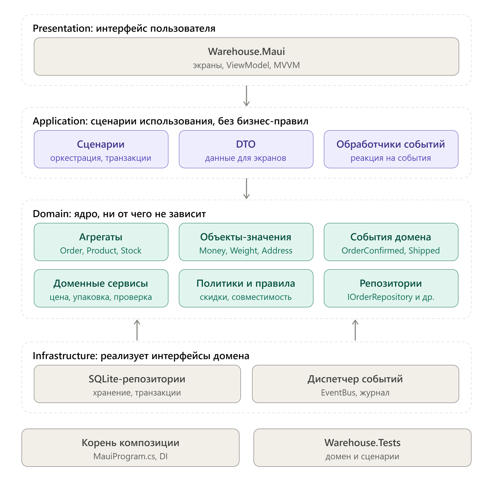

# Warehouse order system

Система комплектации и отгрузки заказов на складе. Моделирует бизнес-правила
склада: резервирование, упаковка с учётом совместимости, расчёт цены, проверка
и отгрузка. Мобильное приложение (MAUI) + консоль, данные в SQLite.

## Авторы
- Чурсина Елизавета
- Маруха Ярослав

## Возможности
- Создание, подтверждение и отмена заказов
- Резервирование и списание остатков
- Скидки: за объём, VIP, сезонная, по промокоду + доставка по весу
- Упаковка: «минимум коробок» и «безопасность прежде всего»
- Проверка перед отгрузкой, упаковочный лист, манифест, отчёты

## Пример работы
1. Склад заполняется товарами: ноутбук, мышь, стиральный порошок, стеклянная ваза, молоко.
2. Создаётся заказ VIP-клиента: 2 ноутбука, 3 упаковки порошка, 1 ваза.
3. Система подтверждает заказ и резервирует товары. Упаковка даёт две коробки. В первой ноутбуки и ваза в усиленной таре с пометкой «хрупкое». Во второй порошок как опасный груз.
4. Считается цена: скидка за объём, скидка VIP, стоимость доставки по весу двух коробок.
5. Выводятся упаковочный лист и манифест, затем заказ отгружается и остатки на складе уменьшаются.
6. Второй заказ запрашивает больше ноутбуков, чем осталось. Система отказывает и объясняет причину.

## Архитектура

## База данных
...

## Запуск
...

## Ограничения
Одно устройство, без сети и синхронизации, одна валюта.
